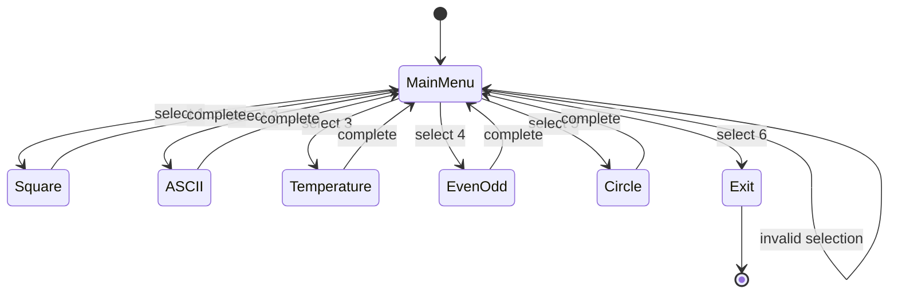

# Activity 2: Refactoring the CLI as a Finite State Machine

Activity 1 moved between the calculator menu and its options by calling more functions. This could easily get confusing with more complicated connections between options. This activity stores the current mode in one state variable and uses one persistent loop to control what runs next.

This is known as a finite state machine (FSM). The program is still a command line interface (CLI), but the design is more explicit and easier to extend. FSMs are a common design pattern in embedded systems, games, and other applications that have a limited number of modes. We will use these *a lot* in Unit 3 & 4! 

## 1. Compile and run

```bash
gcc activity2_fsm_cli.c -o activity2_fsm_cli.out
```

Alternatively:

```bash
make activity2_fsm_cli.out
```

Then run:

```bash
./activity2_fsm_cli.out
```

## 2. Finite state machine

In this program:

- the `enum` defines the possible states;
- the current value of `state` records the application mode;
- a menu selection is an event;
- changing or returning a state creates a transition;
- each `case` performs the action for one state.



The same design can be summarised in a transition table:

| Current state | Event | Next state |
|---|---|---|
| Main menu | User selects circle | Circle |
| Circle | Calculation completed | Main menu |
| Main menu | Invalid selection | Main menu |
| Main menu | User selects exit | Exit |

This is similar to the level of FSM detail expected later in the Unit 2 Software Design journal entry.

## 3. Compare the designs

In Activity 1, an option called `go_back_to_main()`, which called `main_menu()` again. In this version, each state action finishes and returns control to the central loop. The loop changes `state` to control what happens next.

The current mode is therefore explicit and can be inspected while debugging.

## 4. Complete the circle state

Complete `run_circle_state()` so that it:

1. asks the user to enter a radius;
2. rejects a negative radius;
3. calculates the area using `PI * radius * radius`;
4. prints the radius and area to two decimal places.

The circle state should not call the menu. The central FSM already transitions back to `STATE_MAIN_MENU` after the function finishes.

## 5. Manual testing

| Test | Input or action | Expected result | Actual result | Pass/Fail |
|---|---|---|---|---|
| Main menu | Start the program | All six options are displayed |  |  |
| Square | Select `1`, enter `5` | Result is `25`, then the menu returns |  |  |
| ASCII | Select `2`, enter `65` | Character `A` is displayed |  |  |
| Temperature | Select `3`, enter `20` | Result is `68.00 F` |  |  |
| Even or odd | Select `4`, enter `7` | Program reports that `7` is odd |  |  |
| Circle | Select `5`, enter `10` | Area is approximately `314.16` |  |  |
| Negative radius | Select `5`, enter `-2` | Error is shown and the menu returns |  |  |
| Invalid menu number | Enter `9` | Error is shown and the menu returns |  |  |
| Exit | Select `6` | Program enters the exit state and ends |  |  |

Again, no automated shell test is supplied for this interactive activity. ELEC2645 bot needs a break :D
