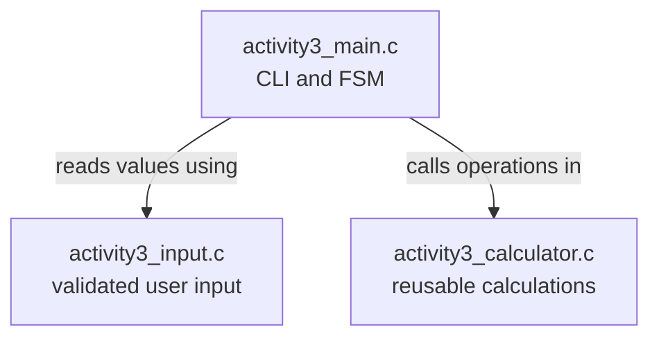

# Activity 3: Modular Code and Robust Input

This activity separates the program into three parts:

- `activity3_main.c` contains the FSM, prompts and printed output
- `activity3_calculator.c` contains reusable calculations
- `activity3_input.c` contains reusable validated input

The associated header files declare the functions shared between source files.

## 1. Software architecture



This is similar to the level of software-architecture detail expected later in the Unit 2 Software Design journal entry.

## 2. Compile and run

Compile all three source files together:

```bash
gcc activity3_main.c activity3_input.c activity3_calculator.c -o activity3_modular_cli.out
```

Alternatively and my preferred method, use the Makefile:

```bash
make activity3_modular_cli.out
```

Then run:

```bash
./activity3_modular_cli.out
```

## 3. Robust input

`read_integer()` reads a complete line using `fgets()`, then uses `sscanf()` to check that the complete input contains one valid integer.

This means the program can reject input such as:

```text
hello
12abc
4.5
```

without becoming stuck or leaving unwanted characters for the next input operation.

The converted integer is returned through a pointer parameter, while the function return value reports success or failure.

## 4. Complete the calculator library

Complete:

- `calculator_multiply()`
- `calculator_divide()`

The calculator library should not call `scanf()` or `printf()`. It should receive inputs through parameters and return results to `main.c`.

## 5. Manual testing

| Test | Inputs | Expected result | Actual result | Pass/Fail |
|---|---|---|---|---|
| Addition | Select `1`, enter `7` and `5` | `12` |  |  |
| Subtraction | Select `2`, enter `7` and `5` | `2` |  |  |
| Multiplication | Select `3`, enter `7` and `5` | `35` |  |  |
| Integer division | Select `4`, enter `20` and `4` | `5` |  |  |
| Division with remainder | Select `4`, enter `9` and `2` | `4` |  |  |
| Division by zero | Select `4`, enter `9` and `0` | Error message, no crash |  |  |
| Invalid menu text | Enter `hello` | Error shown and menu returns |  |  |
| Invalid number | Select an operation, enter `12abc` | Error shown and menu returns |  |  |

Activity 4 will run similar calculation cases automatically without using the CLI or input library.
