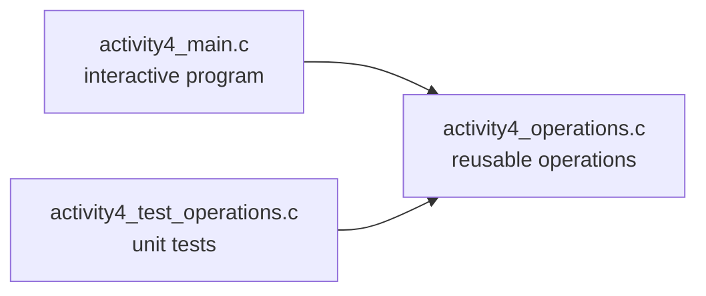

# Activity 4: Compiling and Running Unit Tests

The same operations library is compiled with two different programs:



```text
activity4_main.c + activity4_operations.c
    -> interactive application

activity4_test_operations.c + activity4_operations.c
    -> automated test executable
```

The unit tests call the operation functions directly using known inputs. They do not run the CLI and do not require keyboard input.

## 1. Build the interactive application

```bash
gcc activity4_main.c activity4_operations.c -o activity4_application.out
```

Alternatively:

```bash
make activity4_application.out
```

Run it using:

```bash
./activity4_application.out
```

## 2. Build the unit tests

```bash
gcc activity4_test_operations.c activity4_operations.c -o activity4_tests.out
```

Alternatively:

```bash
make activity4_tests.out
```

Run them using:

```bash
./activity4_tests.out
```

The shortcut:

```bash
make test4
```

builds and runs the test executable.

## 3. Add test cases

Two example tests are supplied. Add tests covering:

- multiplication
- integer division
- zero
- division by zero
- at least one boundary or unusual case of your own

For division by zero, test the success or failure return value. Do not check an uninitialised quotient.

A useful test has a clear name, known inputs and a specific expected result. Its output should identify the expected value, actual value and pass or fail result.

## 4. Deliberately make a test fail

Temporarily change one expected result to an incorrect value and run the tests again. Confirm that:

- the failing test is clearly identified
- expected and actual values are displayed
- the test executable reports failure

Restore the correct expected value before committing your work.
